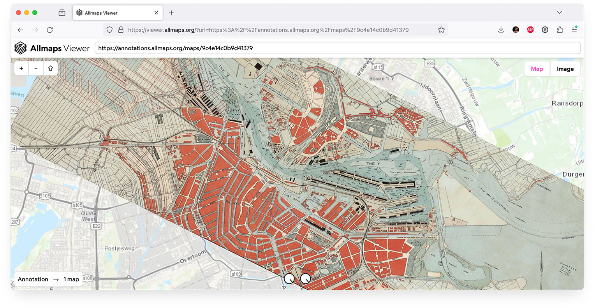

<p align=center><a href="https://allmaps.org"></a></p>

# Allmaps

100,000s of maps are available through [IIIF](https://iiif.io/), across libraries, archives and museums worldwide. Allmaps makes it easier and more inspiring to **curate, georeference and explore collections of digitized maps**.

👉 For more information about the Allmaps project, see [allmaps.org](https://allmaps.org/).

[](https://viewer.allmaps.org/?url=https%3A%2F%2Fannotations.allmaps.org%2Fmaps%2F9c4e14c0b9d41379)

## Contents

Allmaps is an open source project and consists of multiple apps, packages and workers, all written in TypeScript and contained by this monorepo.

Apps:

- [Allmaps Editor](apps/editor)
- [Allmaps Viewer](apps/viewer)
- [Allmaps Latest](apps/latest)
- [Allmaps CLI](apps/cli)
- [Allmaps Explore](apps/explore)
- [Allmaps Here](apps/here)

Packages:

- [@allmaps/annotation](packages/annotation)
- [@allmaps/basemap](packages/basemap)
- [@allmaps/id](packages/id)
- [@allmaps/iiif-parser](packages/iiif-parser)
- [@allmaps/leaflet](packages/leaflet)
- [@allmaps/maplibre](packages/maplibre)
- [@allmaps/openlayers](packages/openlayers)
- [@allmaps/render](packages/render)
- [@allmaps/schemas](packages/schemas)
- [@allmaps/stdlib](packages/stdlib)
- [@allmaps/tailwind](packages/tailwind)
- [@allmaps/transform](packages/transform)
- [@allmaps/triangulate](packages/triangulate)
- [@allmaps/types](packages/types)
- [@allmaps/ui](packages/ui)

Workers:

- [Allmaps Tile Server](workers/tileserver)
- [Allmaps Preview Server](workers/preview)

To see how these components are related, check out the [dependency graph](https://observablehq.com/@allmaps/javascript-dependencies).

## Contributing

We're welcoming contributions! You can read more about the many ways you can contribute [here](./CONTRIBUTING.md).

## License

- **Apps**: all apps are licensed under the [GPL-3.0](https://opensource.org/licenses/GPL-3.0) license, except the homepage and the CLI, which are licensed under the [MIT](https://opensource.org/licenses/MIT) license.
- **Packages**: all packages are licensed under the [MIT](https://opensource.org/licenses/MIT) license.
- **Workers**: all workers are licensed under the [MIT](https://opensource.org/licenses/MIT) license.
- **Data**: georeference data published through the Allmaps project is licensed under the [CC0](https://creativecommons.org/publicdomain/zero/1.0/) license
- **Base map**: [ODbL](https://opendatacommons.org/licenses/odbl/), © [OpenStreetMap](https://www.openstreetmap.org/copyright) contributors. See Protomap's [licensing and attribution guidelines](https://github.com/protomaps/basemaps?tab=readme-ov-file#licensing-and-attribution-guidelines) for more details.

## Installation

Make sure you have Node.js (version 24 or higher) and [pnpm 12](https://pnpm.io/installation) installed. This repository pins its pnpm version in `package.json`.

Then, clone this repository locally:

```sh
git clone https://github.com/allmaps/allmaps.git
cd allmaps
```

For app development, initialize the apps and their dependencies:

```sh
pnpm run init:apps
```

This installs workspace dependencies, builds only the workspaces the apps depend
on, and runs app checks (including SvelteKit initialization). The current apps do
not depend on `@allmaps/render-wasm`, so this workflow does not require Rust or
wasm-pack. It does not build every app for production; dependencies that also
contain an app or demo still run their existing build scripts.

### Package development and full setup

Building all packages requires [Rust and Cargo](https://rust-lang.org/tools/install/)
and [wasm-pack](https://wasm-bindgen.github.io/wasm-pack/installer/) in addition to
Node.js and pnpm. These compile `@allmaps/render-wasm`, which is used by the preview
and tileserver workers. Install Rust using rustup, then install wasm-pack using
its installer or `cargo install wasm-pack`.

To install dependencies, build all packages, and run package checks:

```sh
pnpm run init:packages
```

For the existing full setup, including production app builds:

```sh
pnpm run init
```

The `init` script is a shorthand for the following commands:

1. `pnpm install --recursive`: install all dependencies for all packages and apps.
2. `pnpm run build:packages`: build all packages, including TypeScript, Svelte, and Rust/WASM outputs.
3. `pnpm run check`: run workspace checks and initialize SvelteKit apps.
4. `pnpm run build:apps`: build apps and their dependencies.

If things stop working later on, rerun the initialization script for your workflow.

### API development

For local API development with PGlite or PostgreSQL, see the
[local API workflow](tools/apis/README.md). `pnpm dev:apis` defaults to the local
PGlite database; use `--db=postgres` to connect through `DATABASE_URL`, including
to Neon. Supply a development database URL, never the main or production URL.
The workflow also includes offline migration generation and manual local
migrations with `pnpm db:migrate --db=pglite`. Run `pnpm setup:env` (or
`pnpm setup:env --db=postgres`) to configure missing local settings while preserving
existing values. GitHub login is optional.

For automatic Neon migrations and coordinated API deployments on `develop` and
`main`, see [API migrations and releases](.github/API_RELEASES.md), including the
one-time setup and separate release enable switches.

Development tools are grouped by responsibility: [API runner](tools/apis/README.md),
[demo seed](tools/seed/README.md), [environment setup](tools/setup/README.md), and
[IIIF fixture server](tools/iiif-server/README.md). Integration tests remain in
[test/apis](test/apis/README.md), using temporary PGlite databases and local fixtures.

### App development

After `pnpm run init:apps`, watch and rebuild app dependencies in one terminal:

```sh
pnpm run watch:apps
```

Start the app you are working on in another terminal:

```sh
pnpm --filter "@allmaps/viewer" run dev
```

You can also run `pnpm run dev` from the app's directory. To deliberately start all
app development servers, use `pnpm run dev:apps`. To build apps and their
dependencies for production, use `pnpm run build:apps`.

To prepare only one app instead of all apps, select its dependency graph:

```sh
pnpm install --recursive
pnpm exec turbo run build --filter "@allmaps/viewer^..."
pnpm exec turbo run check --filter "@allmaps/viewer"
```

Then use `pnpm exec turbo watch build --filter "@allmaps/viewer^..."` in the first
terminal and the app's `dev` command in the second. The `^...` selector includes
dependencies without selecting the app itself.

### Package development

After `pnpm run init:packages`, watch and rebuild all packages in one terminal:

```sh
pnpm run watch:packages
```

To run package demos and playgrounds, start their development servers in another:

```sh
pnpm run dev:packages
```

Only packages with a `dev` script start a server. You can also start one playground
with, for example, `pnpm --filter "@allmaps/render" run dev`. Use
`pnpm run build:packages` for a one-time build of all packages.

For a single package, build and watch just that package and its dependencies:

```sh
pnpm install --recursive
pnpm exec turbo run build --filter "@allmaps/transform..."
pnpm exec turbo watch build --filter "@allmaps/transform..."
```

The trailing `...` includes the selected package and its dependencies. This example
does not require Rust because `@allmaps/transform` does not depend on
`@allmaps/render-wasm`.

The existing root commands remain available: `pnpm run init` performs the full
setup described above, `pnpm run build` builds all workspaces, and `pnpm run watch`
watches packages and APIs. Prefer the scoped workflows for app or package work.

## Troubleshooting

If things don't work, it might help to reinitialize the SvelteKit apps:

```sh
pnpm run check
```

Or, reinstall dependencies and create the monorepo's symlinks:

```sh
pnpm install -r
```

As a last resort, you can try to remove some (or all) `node_modules` directories using [npkill](https://npkill.js.org/):

```sh
pnpm dlx npkill
```

## Commit changes

This repository uses [Husky](https://typicode.github.io/husky/) to run type checking, code linting and tests before each commit.

To skip these tests, you can use git's `--no-verify` option:

```sh
git commit --no-verify
```

## Check formatting and types

Check TypeScript types for all packages:

```sh
pnpm run types
```

Run [Prettier](https://prettier.io/) and [ESLint](https://eslint.org/) for all packages:

```sh
pnpm run lint
```

## Run tests

Run tests for all packages and apps:

```sh
pnpm run test
```

Run tests for a single package:

```sh
pnpm --filter "@allmaps/transform" test
```

You can run the tests from the package's directory instead:

```sh
cd packages/transform
pnpm test
```

# Versioning & publishing

Create prerelease versions:

```sh
pnpm run version-prerelease
```

Publish beta versions to npm:

```sh
pnpm run publish-beta
```
